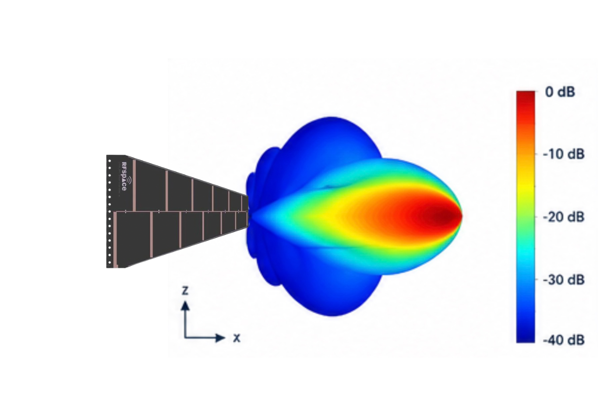

# Antenna Characteristics and Radiation Pattern Estimation

> **Note:** Estimates are based on the antenna specifications and the general characteristics of a log-periodic antenna.

## 1. Technical Specifications

| Parameter | Value |
|:---|:---|
| **Type** | Log-Periodic Dipole Array (LPDA) |
| **Estimated Gain** | 4 to 7 dBi, depending on frequency |
| **Impedance** | 50 Ω |
| **Physical Aperture** | 400 mm |
| **Length** | 500 mm |

## 2. Key Radiation Characteristics

- The main radiation lobe is directed toward the narrow end of the antenna (front side).
- Radiation patterns in the **E-plane** (electric field) and **H-plane** (magnetic field) are used to study antenna directivity in two perpendicular planes.
- The beamwidth is generally wider at lower frequencies and becomes narrower as the frequency increases.
- The presence of sand may affect the antenna's radiation pattern. Experimental tests under actual operating conditions are therefore essential.

## 3. Estimated Radiation Pattern

The radiation pattern shown corresponds to the **E-plane at 900 MHz**.

> ⚠️ **Warning:** This is an estimate based on the antenna specifications and general data for LPDA antennas. These values are not experimental measurements of the antenna being used.

### Estimated Beamwidth Variation

| Frequency | Estimated Beamwidth |
|:---:|:---:|
| 300 MHz | 75° |
| 950 MHz | 60° |

These values must be confirmed through experimental measurements.

## 4. VNA Operating Principles

A **VNA (Vector Network Analyzer)** is an instrument used to characterize electrical networks. It injects an electrical signal into a device under test and analyzes how the signal is reflected or transmitted.

### 4.1. Understanding the S11 and S21 Parameters

A VNA has two ports. The parameters `S11` and `S21` do not refer to port numbers; they are measurable scattering parameters (*S-parameters*).

- **S11:** Measures the signal reflected at the input of the device under test. It is primarily used to evaluate the antenna's impedance matching.
- **S21:** Measures the signal transmitted from port 1 to port 2.

For simplicity, the signal will be assumed to be transmitted from the port located on the right.

The antenna is connected to the VNA using an **N-to-SMA adapter**.

### 4.2. VNA Calibration

The VNA must be calibrated before use with the calibration standards provided.

The three calibration standards are generally:

- **50 Ω Load:** Simulates a matched 50 Ω load.
- **Short Circuit (*Short*):** Connects the center conductor to ground.
- **Open Circuit (*Open*):** Leaves the center conductor electrically open, without a connection to ground.

These standards allow the VNA to compensate for the effects of the measurement setup.

### 4.3. Checking Impedance Matching

The **Smith chart** can be used to evaluate the antenna's impedance matching.

For a characteristic impedance of **50 Ω**, perfect impedance matching corresponds to the center of the Smith chart, representing a normalized impedance of \(1 + j0\).

Actual measurements may deviate from this point depending on frequency, connections, and the measurement environment.

## 5. Frequency Sweep Configuration

To transmit the signal and perform a frequency sweep:

1. Open the **Stimulus** section in the VNA software.
2. Set the **Start Frequency**.
3. Set the **Stop Frequency**.
4. Configure the number of measurement points or the frequency step, depending on the available options.
5. Start the sweep and analyze the measured parameters, particularly `S11`.

The frequency range must be selected according to the antenna's operating bandwidth under investigation.
## 6. Measurement Display (*Display*)

The **Display** menu allows you to choose how measurement results are displayed on the screen. Different types of representations can be selected depending on the parameters you want to analyze.

Examples of available display modes:

- **Logarithmic (Log Mag)**: Displays the magnitude of the measured parameter in decibels (dB), particularly useful for visualizing `S11`.
- **SWR / VSWR** (*Standing Wave Ratio / Voltage Standing Wave Ratio*): Used to evaluate the antenna's impedance matching. A value close to **1** indicates good impedance matching.
- **Smith Chart**: Represents the complex impedance and allows you to visualize the antenna's impedance matching across the frequency range under investigation.
- **Phase**: Displays the phase of the measured signal as a function of frequency.
- **Magnitude**: Displays the magnitude of the measured parameter in the selected format.

The choice of display depends on the measurement objective. To assess the antenna's impedance matching, the **S11 in dB**, **SWR**, and **Smith Chart** displays are particularly useful.
