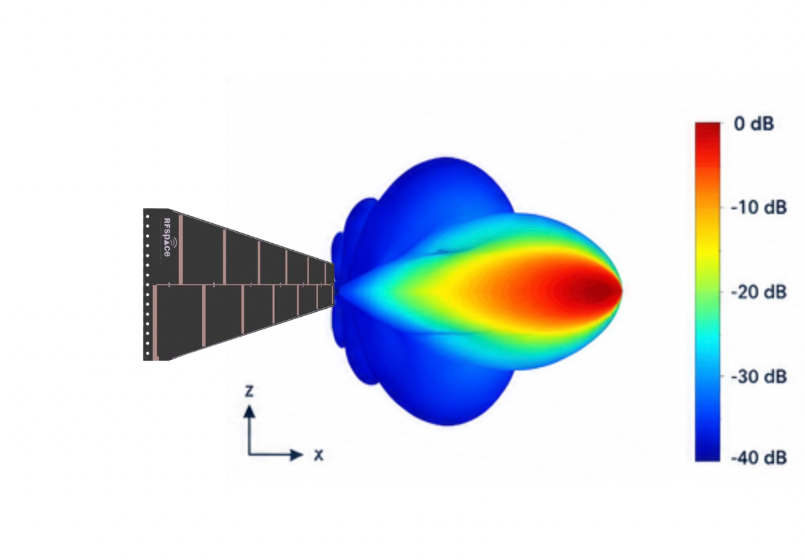

## Description technique LPDA-MAX

Le LPDA-MAX est une antenne PCB, conçue selon le principe logarithmique-périodique (LogPer). Le gain est d'environ 4 à 7 dBi sur la gamme de fréquences de 300 à 1000 MHz.  
  
Pour le montage, l'antenne à polarisation linéaire offre des trous de montage avec un espacement de 1 pouce à l'extrémité du circuit imprimé. Connexion SMA, TOS typ. meilleur que 2.0:1, impédance 50 Ohm, puissance d'émission max. 25 Watt.  
  

## Description de l’application LPDA-MAX

Le LPDA-MAX est une antenne dont les éléments sont montés alternativement sur le haut et le bas d'un PCB, et dont la longueur et l'espacement suivent un calcul logarithmique. Cette conception est appelée log-périodique (LogPer) et offre une énorme largeur de bande avec un gain relativement constant et une courbe de TOS plate.  
  
Les applications de ces antennes sont nombreuses : outre les dispositifs IOT dans la gamme ISM et LoraWAN (433 et 868 MHz), les systèmes LTE et GSM (800 - 960 MHz) peuvent également utiliser cette antenne. Dans le domaine technico-scientifique, ces antennes sont utilisées, par exemple, pour les radars terrestres.
---------------------------------------------------------------------
# Caractéristiques de l’antenne et estimation du diagramme de rayonnement

> **Remarque :** Les estimations sont fondées sur les spécifications de l’antenne et sur les caractéristiques générales d’une antenne log-périodique.

## 1. Caractéristiques techniques

|Parameter|Value|
|:--|:--|
|Paramètre|Valeur|
|:--|:--|
|**Type**|Réseau dipolaire log-périodique (LPDA)|
|**Gain estimé**|4 à 7 dBi, selon la fréquence|
|**Impédance**|50 Ω|
|**Ouverture physique**|400 mm|
|**Longueur**|500 mm|

## 2. Principales caractéristiques du rayonnement

- Le lobe de rayonnement principal est dirigé vers l’extrémité étroite de l’antenne (face avant).
- Les diagrammes de rayonnement dans le **plan E** (champ électrique) et le **plan H** (champ magnétique) servent à étudier la directivité de l’antenne dans deux plans perpendiculaires.
- Le faisceau est généralement plus large aux basses fréquences et se resserre lorsque la fréquence augmente.
- La présence de sable peut modifier le diagramme de rayonnement de l’antenne. Des essais dans les conditions réelles d’utilisation sont donc indispensables.

## 3. Diagramme de rayonnement estimé

Le diagramme de rayonnement présenté correspond au **plan E à 900 MHz**.

> ⚠️ **Avertissement :** Il s’agit d’une estimation fondée sur les spécifications de l’antenne et sur des données générales concernant les antennes LPDA. Ces valeurs ne proviennent pas de mesures expérimentales réalisées sur l’antenne utilisée. 

### Variation estimée de la largeur de faisceau

|Fréquence|Largeur de faisceau estimée|
|:-:|:-:|
|300 MHz|75°|
|950 MHz|60°|

Ces valeurs doivent être confirmées par des mesures expérimentales.

## 4. Principes de fonctionnement d’un VNA

Un **VNA (analyseur de réseau vectoriel)** est un instrument utilisé pour caractériser des réseaux électriques. Il injecte un signal électrique dans un dispositif sous test et analyse la manière dont ce signal est réfléchi ou transmis.

### 4.1. Comprendre les paramètres S11 et S21

Un VNA possède deux ports. Les paramètres `S11` et `S21` ne désignent pas les numéros des ports ; ce sont des paramètres de diffusion mesurables (_paramètres S_).

- **S11 :** Mesure le signal réfléchi à l’entrée du dispositif sous test. Il sert principalement à évaluer l’adaptation d’impédance de l’antenne.
- **S21 :** Mesure le signal transmis du port 1 vers le port 2.

Par souci de simplicité, on supposera que le signal est transmis depuis le port situé à droite.

L’antenne est connectée au VNA à l’aide d’un **adaptateur N vers SMA**.

### 4.2. Étalonnage du VNA

Le VNA doit être étalonné avant utilisation à l’aide des standards d’étalonnage fournis.

Les trois standards d’étalonnage sont généralement les suivants :

- **Charge 50 Ω :** Simule une charge adaptée de 50 Ω.
- **Court-circuit (_Short_) :** Relie le conducteur central à la masse.
- **Circuit ouvert (_Open_) :** Laisse le conducteur central électriquement ouvert, sans connexion à la masse.

Ces standards permettent au VNA de compenser les effets du dispositif de mesure.

### 4.3. Vérification de l’adaptation d’impédance

Le **diagramme de Smith** peut être utilisé pour évaluer l’adaptation d’impédance de l’antenne.

Pour une impédance caractéristique de **50 Ω**, une adaptation parfaite correspond au centre du diagramme de Smith, qui représente une impédance normalisée de (1 + j0).

Les mesures réelles peuvent s’écarter de ce point en fonction de la fréquence, des connexions et de l’environnement de mesure.

## 5. Configuration du balayage en fréquence

Pour transmettre le signal et effectuer un balayage en fréquence :

1. Ouvrir la section **Stimulus** du logiciel du VNA.
2. Définir la **fréquence de début**.
3. Définir la **fréquence de fin**.
4. Configurer le nombre de points de mesure ou le pas fréquentiel, selon les options disponibles.
5. Démarrer le balayage et analyser les paramètres mesurés, notamment `S11`.

La plage de fréquences doit être choisie en fonction de la bande passante de fonctionnement de l’antenne étudiée.

## 6. Affichage des mesures (_Display_)

Le menu **Display** permet de choisir la manière dont les résultats des mesures sont affichés à l’écran. Différents types de représentations peuvent être sélectionnés selon les paramètres à analyser.

Exemples de modes d’affichage disponibles :

- **Logarithmique (Log Mag)** : Affiche l’amplitude du paramètre mesuré en décibels (dB), ce qui est particulièrement utile pour visualiser `S11`.
- **ROS / VSWR** (_Rapport d’ondes stationnaires / Voltage Standing Wave Ratio_) : Sert à évaluer l’adaptation d’impédance de l’antenne. Une valeur proche de **1** indique une bonne adaptation d’impédance.
- **Diagramme de Smith** : Représente l’impédance complexe et permet de visualiser l’adaptation d’impédance de l’antenne sur la plage de fréquences étudiée.
- **Phase** : Affiche la phase du signal mesuré en fonction de la fréquence.
- **Amplitude** : Affiche l’amplitude du paramètre mesuré dans le format sélectionné.

Le choix de l’affichage dépend de l’objectif de la mesure. Pour évaluer l’adaptation d’impédance de l’antenne, les affichages **S11 en dB**, **ROS** et **diagramme de Smith** sont particulièrement utiles.